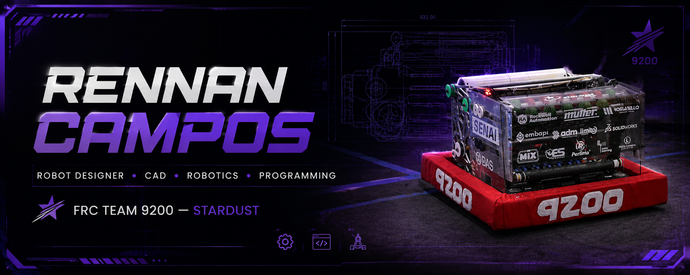

<p align="center">
  
</p>

<p align="center">
  
</p>

<p align="center">
  
  
  
  
</p>

<p align="center">
  <a href="https://github.com/rennancampos2001-debug">
    
  </a>
</p>

---

# About Me

I'm a technology student focused on **robotics, mechanical design, CAD and programming**.

I'm part of **FRC Team 9200 — Stardust**, where I work primarily with robot design, mechanical development and CAD.

My main interests are designing mechanisms, solving engineering problems and transforming ideas into **functional, manufacturable and reliable systems**.

I'm also expanding my programming skills in **Python and Java**, with the goal of combining mechanical engineering and software development in robotics.

<p align="center">
  
</p>

# Quick Profile

<table align="center">
<tr>
<td align="center" width="180">

### ROLE

Robot Designer

</td>

<td align="center" width="180">

### FOCUS

Mechanical Design

</td>

<td align="center" width="180">

### ROBOTICS

FRC

</td>

<td align="center" width="180">

### LOCATION

Brazil

</td>
</tr>
</table>

---

# FRC Team 9200 — Stardust

## Robot Designer

I work primarily with **robot design and mechanical development**, using CAD to transform concepts into functional mechanisms for competitive robotics.

### Areas of Work

* Mechanical Design
* CAD Modeling
* Mechanism Development
* Robot Assemblies
* Prototyping
* Design Iteration
* Manufacturing-oriented Design
* Mechanical Integration
* Engineering Documentation

<br>

<p align="center">
  
</p>

<p align="center">
  <sub>FRC Team 9200 — Stardust</sub>
</p>

---

# 2026 FIRST Championship

<table align="center">
<tr>
<td align="center">

**TEAM**

<br>

FRC Team 9200 — Stardust

</td>

<td align="center">

**REGIONAL**

<br>

Limeira, São Paulo, Brazil

</td>

<td align="center">

**CHAMPIONSHIP**

<br>

FIRST Championship 2026

</td>

<td align="center">

**LOCATION**

<br>

Houston, Texas, USA

</td>
</tr>
</table>

---

# Awards & Recognition

<p align="center">
  
</p>

<p align="center">
  
</p>

---

# CAD & Mechanical Design

Mechanical design is one of my main technical focuses.

## Software

<p align="center">
  
  
</p>

## Focus Areas

```text
3D MODELING
      │
      ▼
MECHANISM DEVELOPMENT
      │
      ▼
ASSEMBLIES
      │
      ▼
PROTOTYPING
      │
      ▼
TESTING
      │
      ▼
DESIGN ITERATION
      │
      ▼
MANUFACTURING
      │
      ▼
ROBOT INTEGRATION
```

> My goal is not only to create models that look good, but to develop designs that can actually be **manufactured, assembled, tested and improved**.

---

# Featured Projects

## Stardust 9200 — 2026 Robot

<p align="center">
  
</p>

Mechanical design and CAD development for the **2026 FRC robot**.

**Project documentation coming soon.**

---

## Mechanical Design Projects

CAD studies and mechanical projects focused on:

`Robotics` `Mechanisms` `CAD` `Engineering` `Manufacturing`

**Projects coming soon.**

---

## Programming Projects

Programming projects developed while studying software development and programming fundamentals.

**Projects coming soon.**

---

# Programming

I'm currently expanding my programming skills with a focus on **robotics and software development**.

## Languages

<p align="center">
  
</p>

## Development Tools

<p align="center">
  
</p>

---

# Tech Stack

<table align="center">
<tr>
<td align="center" width="50%">

## CAD & Engineering

`Autodesk Inventor`

`SolidWorks`

`Mechanical Design`

`3D Modeling`

`Assemblies`

</td>

<td align="center" width="50%">

## Programming

`Python`

`Java`

`HTML`

`Git`

`GitHub`

</td>
</tr>
</table>

---

# Currently Learning

<p align="center">
  
</p>

<p align="center">
  
</p>

<p align="center">
  
</p>

<p align="center">
  
</p>

<p align="center">
  
</p>

---

# My Journey

<p align="center">
  
</p>

```text
PROGRAMMING
     ↓
ROBOTICS
     ↓
MECHANICAL DESIGN
     ↓
CAD
     ↓
FRC TEAM 9200
     ↓
FIRST CHAMPIONSHIP 2026
     ↓
ENGINEERING + SOFTWARE
```

---

# GitHub Statistics

<p align="center">
  

  
</p>

---

# Contribution Activity

<p align="center">
  
</p>

---

# Contact

<p align="center">

<a href="https://github.com/rennancampos2001-debug">
  
</a>

<a href="mailto:rennancampos2001@gmail.com">
  
</a>

</p>

<p align="center">
  LinkedIn — Coming soon
</p>

---

<p align="center">
  
</p>

<p align="center">

<strong>LEARN • DESIGN • BUILD • COMPETE • EVOLVE</strong>

<br>

<sub>Mechanical Design × Robotics × Programming</sub>

</p>
